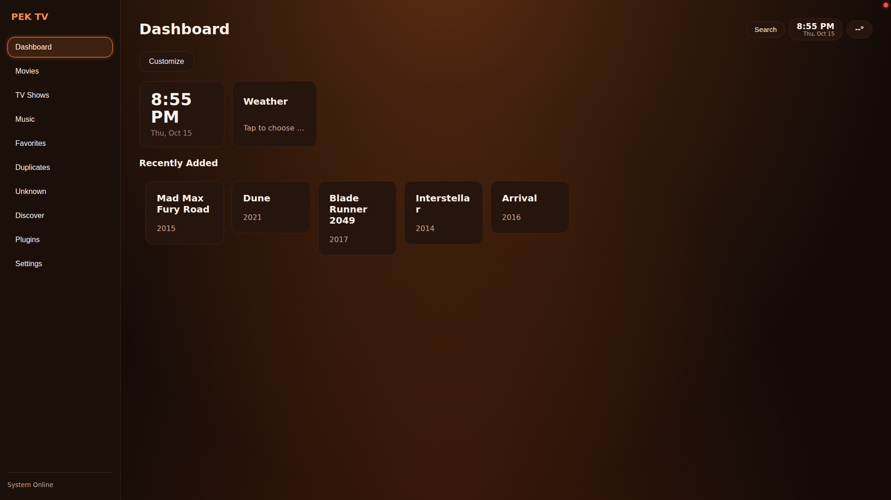
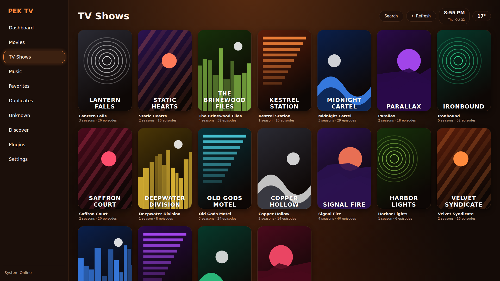
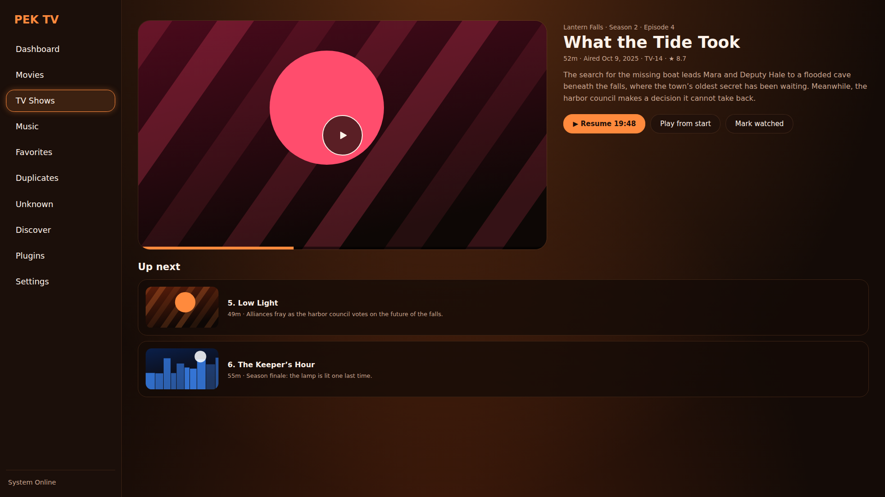
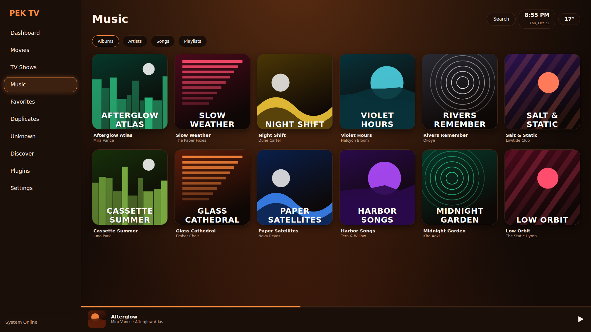

# PEK TV

A media center with a sandboxed plugin system, network library support and a TV-first interface. It is in beta, so expect rough edges.

Website:
https://pek-tv.web.app

## Screenshots

PEK TV running at 1920x1080.

| | |
|---|---|
|  **Dashboard** |  **TV Shows library** |
|  **Show page** |  **Episode details** |
|  **Settings** |  **Music library** |
|  **Music: Now Playing** | |

> **About the artwork in these screenshots.** The movie and show posters, episode stills and album covers shown are **stand-ins**: plain generated gradient images with a title on them, made for these screenshots. They are not the official artwork. Real posters, stills and album covers are copyrighted by their owners, so none are included in this repository. The titles, descriptions, episode text, artist names and album and song titles shown are invented sample entries for demonstration only. All titles and names mentioned are the property of their respective owners, and PEK TV is not affiliated with or endorsed by them. In normal use PEK TV shows artwork from your own files or fetches it from TMDB for your own library.

## What it does

- **Your library, everywhere:** local folders and network shares (SMB, NFS, FTP, WebDAV, UPnP/DLNA). Reads Kodi-style NFO files and artwork first, and asks TMDb only for what is missing.
- **A player that stays out of the way:** libmpv. Automatic subtitles, Skip Intro / Skip Recap, and an Up Next card.
- **Music from your own folders:** albums, artists, songs, playlists and search over the same local and network folders. Tags and cover art are read from the files; shuffle, repeat, a queue and a player bar. Songs play in libmpv on Android. Files that will not open (for example a 0-byte or damaged file) are marked "Can't be played" and skipped, and a home-screen widget shows the song that is playing (phones and tablets). See `MUSIC.md`.
- **Built for the couch:** D-pad, remote and gamepad support, with a 10-foot look.
- **A dashboard you design:** widgets you choose and order, saved per profile.
- **Profiles and PEK Cloud:** profiles with their own history and favorites, plus optional cloud sync.
- **Skins:** install a skin from a `.zip`. Skins cannot run code or reach the network.
- **Sandboxed plugins:** plugins declare what they may do and run in a locked-down sandbox.

See `PLUGINS.md`, `SKINS.md`, `SUBTITLES.md`, `LOCAL_METADATA.md` and `MUSIC.md` for details.

## Project layout

- `flutter_ui/`: the app's screens (Flutter). The only UI.
- `backend/`: the C++ server (library scanner, network sources, music, torrent streaming, subtitles).
- `android/`: the Android app (start-up, libmpv player, Python plugin host) and the GitHub Actions build.
- `plugins/`, `plugin_packages/`, `skins/`: built-in plugins and skins (Weather, TMDb Discover, Skin maker); `plugin_packages/` holds the plugins published on the PEK Store (M3U8, Trakt).
- `cloud/`: the Cloudflare workers (accounts and sync, plugin store).
- `assets/`: branding artwork: launcher icon, TV banner, splash videos (`assets/android/res`) and README screenshots.
- `tools/`: helper scripts (`make_skin.py`, `sync_providers.js` with `providers.json`).

## Legal

See the `LICENCE` file for what you may and may not do with the code.

PEK Industries is not associated with any illegal activity involving torrents. PEK TV does not host, provide or link to any content, and ships with no search provider or index. You are responsible for what you play.

This product uses the TMDB API but is not endorsed or certified by TMDB. Streaming availability data provided by JustWatch.
